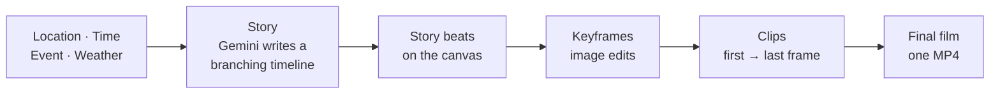

<div align="center">

# SceneSplice

**Splice scenes through time.**
Ruin a building, or ask "what if?" about a real street and watch a branching story unfold, with images and video generated on your own ComfyUI.


</div>

---

## What it does

SceneSplice is a web front end for ComfyUI with two tools that share one app shell.

### Decay Studio
Upload a pristine architectural render (or pick a real address and capture a 3D white-box model of its surroundings), scrub the **Chrono-Slider** from 10 to 10,000 years, choose an atmosphere, and get an animated ruin video back.

- FLUX Kontext edits the image into a ruined keyframe.
- LTX-2.5 (22B distilled, with audio) animates it.

### WhatIfStreet
Pick a real street, a moment in the past or future, a world-changing event (a "butterfly event") and the weather. SceneSplice writes a **branching storyline** of how that street changes, then turns each story beat into an image and a video.

- Draggable, zoomable **storyline canvas**: a beat's horizontal position is *when* it happens.
- Beats are edited from the street's Street View photo, chained one after another.
- Clips can be joined into a single **final film**.



## Quick start

**Requirements:** Node.js 22.6 or newer, and a reachable ComfyUI server (local, tunnelled, or [Comfy Cloud](https://cloud.comfy.org)).

```sh
npm install
cp .env.example .env.local     # then set COMFY_URL
npm run dev                    # http://127.0.0.1:3000
```

| Script | What it does |
| --- | --- |
| `npm run dev` | Start the dev server on `127.0.0.1:3000` |
| `npm run build` / `npm start` | Production build and server |
| `npm test` | Unit tests, then a TypeScript type-check |

## Configuration

Everything below can also be set in the app (gear icon, top right), which overrides these values per browser.

| Variable | Purpose |
| --- | --- |
| `COMFY_URL` | Your ComfyUI server, e.g. `http://127.0.0.1:8188`. The app proxies it at `/comfy`, so the browser needs no CORS access. |
| `COMFY_CLOUD_API_KEY` | Optional. Used when "Comfy Cloud" is selected and no key was entered in Settings. |
| `GOOGLE_MAPS_API_KEY` | Street View for WhatIfStreet. Server-side only. |
| `NEXT_PUBLIC_COMFY_WS_URL` | Optional direct WebSocket (e.g. `ws://host:8188/ws`) for live step progress. Without it the UI polls and shows elapsed time. |

> **Note:** the story and video-prompt steps use Gemini through ComfyUI. On Comfy Cloud that needs a paid plan with API access.

Turn on **Use API models** in Settings to render keyframes with Nano Banana Pro and videos with Seedance 2.5 instead of FLUX and LTX. This applies to WhatIfStreet only.

## How the storyline canvas works

- **Time is the X axis.** Drag a beat sideways to change its date. A beat can't move before its parent or after its first child.
- **Two independent zooms.** Scroll to change the time scale (beats spread apart or together). Use the *Node size* slider, or Ctrl+scroll, to resize nodes. Neither affects the other.
- **Down to months.** The axis switches between years, quarters and months as you zoom, and dragging snaps to the visible grid.
- **Branching.** `+` on a beat's edge adds a child; the trash icon deletes it and everything beneath it.
- **Keyframe 0** is the original street photo, locked to the left of the first beat. Every storyline hangs from it.

## Project layout

| Path | Purpose |
| --- | --- |
| `components/app-shell.tsx` | Page header, tool tabs, settings |
| `components/studio.tsx` | Decay Studio flow |
| `components/scenario/` | WhatIfStreet: inputs, status bar, detail panel, final film |
| `components/storyline/storyline-canvas.tsx` | The pan/zoom storyline canvas and timeline axis |
| `lib/storyline.ts` | Story tree model, layout, time scale (pure, tested) |
| `lib/scenario.ts` | Story framing and parsing/repair of the model's JSON |
| `lib/comfy.ts` | ComfyUI client: upload, queue, progress, results, cancel |
| `lib/*-workflow.ts` | Inject UI values into workflow graphs |
| `lib/geo.ts`, `lib/whitebox.ts` | Address search, OpenStreetMap buildings, 3D white-box capture |
| `workflows/` | ComfyUI workflow graphs (API format) |
| `app/api/` | Server routes: geocoding, buildings, Street View, settings |
| `test/` | Unit tests (`node --test`) |

## Documentation

- [Storyline and WhatIfStreet design](docs/storyline.md): flow, time model, keyframes, video, final film, limitations.
- [Design plans](docs/plans/): earlier design notes for the map white-box and WhatIfStreet.

## Status

SceneSplice is an early prototype. The logic and ComfyUI stages are tested or have been run against a live server; the React components are type-checked and built but have had limited click-testing. See *Known limitations* in [docs/storyline.md](docs/storyline.md).

## License

MIT, see [LICENSE](LICENSE). Originally based on [Comfy-Org/comfy-reshoot](https://github.com/Comfy-Org/comfy-reshoot); third-party notices are in [THIRD_PARTY_NOTICES/](THIRD_PARTY_NOTICES/).
